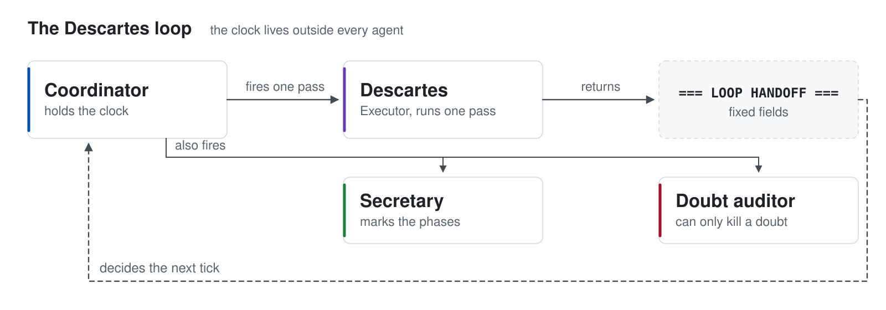

# Descartes (Cartesius)

**A discovery engine for data reuse.** Take public data that already exists, and produce a closed, reproducible finding the original study left open, one hypothesis at a time, with every finding checked by a second, independent method before it is trusted.

The engine is four markdown files and a protocol. There is nothing to install, no service to run, and no framework to learn. The files are not the contribution. The method they carry is.

> **Nothing is believed on the first look.** Every finding must be reproducible from a committed script, re-checked by an independent method before it is trusted, and carried with an explicit confidence. A single pass is where the errors are; one look is not enough to trust a result. The loop exists to sort what can be believed from what cannot. An honest negative is a result, and a null is never inflated into a signal.

<p align="center">
  <picture>
    <source media="(prefers-color-scheme: dark)" srcset="docs/figures/workflow-dark.svg">
    
  </picture>
</p>

---

## Why this exists

Producing a result from data that already exists costs far less than producing the data did. That moves the hard part: it is no longer getting a number, it is **establishing that the number holds**. An engine that returns findings quickly and cannot catch its own errors produces plausible output faster than anyone can check it.

So this engine is built around the opposite objective. Its most important output so far is a **retraction**: in its first end-to-end run, the headline finding turned out to be a design artefact, and the engine is what caught it. See [`examples/mpra-eqtl-discordance`](examples/mpra-eqtl-discordance/).

---

## How it works

Four roles, deliberately separated, because **the separation is what made the self-corrections possible in the one run closed so far**. A single agent doing everything shares its blind spot across every layer and has no way to see it.

| Role | Agent | What it does |
|---|---|---|
| **Executor**, *Descartes* | [`data-reuse-discovery-ant`](agents/data-reuse-discovery-ant.md) | Runs one pass per invocation: pre-registers the hypothesis, runs it from committed scripts, grades every finding with a confidence, returns a handoff block. |
| **Doubt auditor** | [`ant-doubt-auditor`](agents/ant-doubt-auditor.md) | Judges whether each doubt the executor ran was a *real* doubt. It can only `KILL` or `SURVIVES`, and **it cannot propose anything.** |
| **Secretary** | [`ant-status-secretary`](agents/ant-status-secretary.md) | Marks every phase ✅/⚠️/❌/⏳ against the protocol, on file evidence only. Runs nothing. |
| **Coordinator** | [`COORDINATOR.md`](COORDINATOR.md) + [`/descartes-loop`](commands/descartes-loop.md) | Holds the clock. Fires one pass, parses the handoff, decides what runs next. |

The loop's heartbeat is **external by design**: the executor is forbidden from scheduling itself, so the coordinator is the only piece that sees the clock. A human firing each pass by hand is a valid heartbeat.

### Why the auditor can only delete

A perpetual doubter eventually runs out of honest doubt, and then the structural temptation is to **fabricate a doubt to justify the pass**, while being the worst possible judge of whether it did. An agent that can only delete never needs to invent in order to justify itself, and its failure mode (over-pruning) is the *opposite* of the executor's (fabricating). Opposite failure modes contain each other. Two doubters that share a failure mode just validate each other, which is theatre. See [`docs/ROLE_SEPARATION.md`](docs/ROLE_SEPARATION.md).

---

## The cycle

Pre-phase 0 reconnaissance, then seven phases, in [`PROTOCOL.md`](PROTOCOL.md):

| | Phase | The rule it enforces |
|---|---|---|
| 0 | Reconnaissance | Search in two passes: build, then **refute**. Stand on the authors' own stated gap. |
| 1 | Rationale + hypothesis | Freeze the mechanism and every definition *before* looking, so the hypothesis cannot be written after the result is known (HARKing). |
| 2 | Acquisition + verification | **Test the join, not the filename.** Filenames lie. |
| 3 | Test, model-free first | Reproduce the paper's own number as a sanity light before believing anything. |
| 4 | Enhancement with SOTA | Verify tools against the live web, never against training memory. |
| 5 | Self-audit + retraction | Catch and **retract** artefacts rather than reporting them. |
| 6 | Reproducibility QC | Every number traces to a committed script; figures read their numbers from files. |
| 7 | Close + translation | A close is positive **or** negative-diagnostic. Both are results. |

Findings move `SUSPECT → PLAUSIBLE → CONFIRMED` only on agreement between genuinely independent methods, and carry a flip count because a claim that has reversed four times is not the same claim as one that held ([`docs/CONFIDENCE_MODEL.md`](docs/CONFIDENCE_MODEL.md)). Doubt is aimed up a five-rung ladder, and running out of doubt at one rung means climbing, never fabricating ([`docs/DOUBT_LADDER.md`](docs/DOUBT_LADDER.md)).

---

## Quickstart

```sh
git clone https://github.com/blinkeado/descartes.git
cd /path/to/your/project
/path/to/descartes/scripts/install.sh .     # agents, command, protocol
/path/to/descartes/scripts/bootstrap.sh     # the nine empty ledgers
```

Then pre-register your first ant in `ANT_REGISTRY.md` **before touching any data**, and fire the first pass. Full walkthrough in [`docs/ADOPTING.md`](docs/ADOPTING.md).

---

## Repository map

| Path | What it holds |
|---|---|
| [`PROTOCOL.md`](PROTOCOL.md) | The canonical workflow: phases, decision rules, confidence model |
| [`COORDINATOR.md`](COORDINATOR.md) | The heartbeat contract: who fires whom, what the handoff drives |
| [`agents/`](agents/) | The three agent definitions, Descartes among them, ready to drop into `.claude/agents/` |
| [`commands/`](commands/) | `/descartes-loop`, one coordinator tick as a slash command |
| [`templates/`](templates/) | The nine ledgers, headed and empty |
| [`docs/`](docs/) | Handoff spec, confidence model, doubt ladder, role separation, failure modes, adoption guide |
| [`examples/`](examples/) | A closed end-to-end case, with the figures reproducible from JSON |
| [`scripts/`](scripts/) | `install.sh`, `bootstrap.sh` |

---

## Workflow definitions and research records

`agents/`, `COORDINATOR.md`, `PROTOCOL.md`, `commands/` and `docs/` define how the workflow is intended to operate. The files in `templates/` are empty starting points. A run's own records are needed to establish which instructions were used, what happened, and what was corrected.

Record the exact engine commit and any project-specific instructions for each run. Workflow definitions can be shared publicly while research records are shared separately with controlled access. Preserve original records and identify any anonymized copies. See [`docs/SHARING.md`](docs/SHARING.md).

---

## Glossary

**ANT** is the engine. An **ant** is one unit of its work: a single hypothesis taken end to end, pre-registered before the data is touched and closed either positive or negative-diagnostic. One ant at a time, never five half-done.

**Descartes** is the executor's proper name, after *de omnibus dubitandum*: everything must be doubted. It is one of the four roles, not the whole engine, and the repository is named after it because doubting is what the engine is for. **Cartesius** is the Latin he published under, and the root of *Cartesian*. There is a second reading the engine earns: in Spanish, *descartes* also means **the discards**, and most of what this engine produces is the part it threw away.

---

## Honest scope

- **This is an orchestration pattern with a human in the loop**, not an autonomous research system. The human supplies domain judgement and decides which hypothesis is worth running.
- **The engine finds nothing by itself.** It tests what it is given and refuses to believe the result too early. Most of its outputs are negatives, and that is the point.
- **Translating a verified table into a finding that means something in your field is the human's job**, not the engine's. The engine closes the loop; it does not know what the result means in your discipline.
- **Two search passes reduce error; they do not eliminate it.** A further pass can still surface evidence, or an explanation, that the first two missed.

## License

MIT. See [`LICENSE`](LICENSE).
