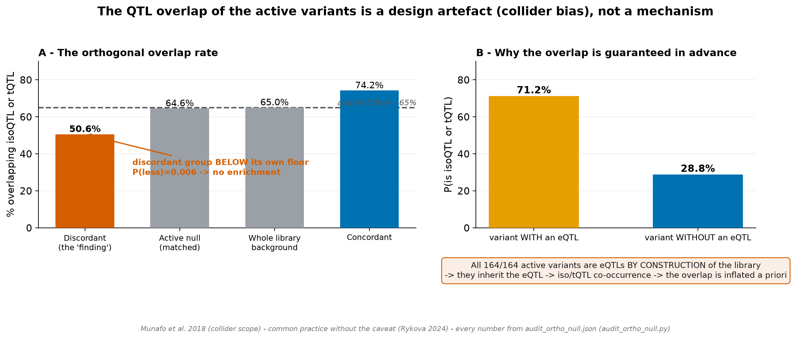
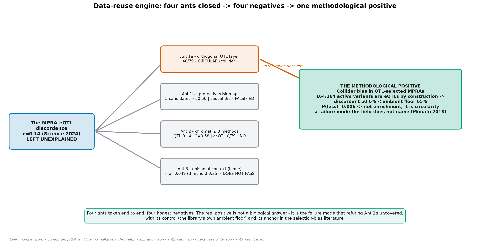

# Case study: the MPRA vs eQTL discordance

The engine's first end-to-end run. It is included here because a protocol document is a claim and a closed case is a receipt: every rule in [`../../PROTOCOL.md`](../../PROTOCOL.md) exists because something in this run went wrong in a way that rule now prevents.

**Built with Claude: Life Sciences** (Research track, dataset #2, lentiMPRA in fetal cortex). Source data from the Pollard & Ahituv labs at Gladstone; source paper Deng, Whalen & Pollard, *Science* 2024. All data used is public; every number below re-derives from a committed script.

---

## The gap

The paper reports that variant effects measured in the MPRA agree with eQTL effects only weakly, about 55% same-direction with r of about 0.14, and does not explain why. That is the authors' own stated gap, which is the most defensible place to stand (`PROTOCOL.md` decision rule 2).

The obvious analysis, training a model and running in-silico mutagenesis, is what the paper already did. The gap it left open was the discordance itself.

## The result, in one paragraph

**Four hypotheses, four negatives.** The discordance resisted splicing, transcript level, chromatin (ruled out by three independent methods) and episomal context. The positive that came out of the run is not biological. It is methodological: **the headline finding of the first ant turned out to be collider bias**, a failure mode that is structurally present in any MPRA library selected from QTLs, and the run produced the control that demonstrates it. The engine's own output was the thing the engine refuted.



---

## What each ant did

| Ant | Frozen hypothesis | Outcome | What actually happened |
|---|---|---|---|
| **1a** | An orthogonal regulatory layer (splicing, transcript, chromatin) explains part of the discordance | ✅ closed **negative** | Looked positive (40/79 discordant variants overlap an orthogonal QTL layer) until pass 5 refuted it as circular: the library was selected from QTLs, so the overlap was guaranteed before any analysis ran |
| **1b** | The risk allele's direction of effect maps onto the direction of disease dysregulation, flagging protective candidates | ✅ closed **negative-diagnostic** | Falsified. 11 of 22 anchors classifiable, split 5 protective / 6 risk ≈ chance (p ≈ 1.0); the causal gold standard was reachable for 0 of 5 |
| **2** | The discordant variants act through chromatin accessibility in *developing* cortex, which the adult chromatin QTL could not see | ✅ closed **negative-diagnostic** | 0 of 79 are a significant fetal caQTL (expected 0.59, P = 1.0; concordant 0/66; background 0.74%). Chromatin ruled out by a **third** independent method, in the correct tissue |
| **3** | Genomic context distinguishes discordant from concordant variants (the episomal-vs-chromosomal axis) | ✅ closed **negative**, false positive caught | A contaminated composite produced a spurious pass; recomputed correctly, ρ = 0.049 (CI −0.115 to +0.210), below the pre-registered 0.25 threshold |



---

## The central finding: collider bias in QTL-selected MPRAs

The MPRA library was selected from brain QTLs. Therefore **all 164 differentially active variants are eQTLs by construction.** Any downstream question of the form "do the discordant variants overlap QTL layers?" has its answer guaranteed in advance: this is selection on a common descendant, not mechanistic signal.

Quantified (every value from `audit_ortho_null.py` → `audit_ortho_null.json`):

| Group | n | Overlaps isoQTL ∨ tQTL |
|---|---|---|
| **Discordant** (the apparent finding) | 79 | **50.6%** |
| Matched active null (non-DAV) | 6,878 | 64.6% |
| **Whole library background** (the ambient floor) | 13,884 | **65.0%** |
| Concordant | 66 | 74.2% |

The discordant group overlaps **below its own library's ambient floor**: binomial P(less) = 0.006 against 65.0%, Fisher OR = 0.56, p = 0.013 against the matched null. That is not enrichment. It is circularity, and the direction of the effect is the tell: a real mechanism would have pushed the rate *up*.

The mechanism of the floor is QTL co-occurrence inherited from the selection: P(iso/tQTL | has an eQTL) = **71.2%** versus **28.8%** without. Within the discordant group itself, 39 of the 52 that carry an eQTL overlap, against 1 of the 27 that do not.

**Why this generalizes.** The phenomenon has a formal name, collider bias (Munafò et al. 2018, *Int J Epidemiol*, PMID 29040562), and selecting MPRA libraries from eQTLs is common practice. The specific warning, that the resulting QTL overlap is structurally inflated, does not appear in the indexed literature: targeted searches returned 0 or 1 hits, none stating the failure mode. A reusable caveat for anyone reanalyzing this class of data is a legitimate product of data reuse.

**Honest bound on that claim:** generalizing the circularity to *every* QTL-selected MPRA is a supported argument, not a demonstration over N libraries.

---

## Who caught what

The role separation is not decoration. Each self-correction below was caught by a role that could see what another structurally could not.

| What was wrong | Who caught it | Why that role and not another |
|---|---|---|
| The whole analysis was planned on the wrong genome build; the bridge table needed to harmonize alleles only exists in the older build (0 matches vs 61) | **Executor** | It tested the real join while the orchestrator reasoned in the abstract. Filenames lie. |
| A chromatin scorer reported "39 of 40 affected", a saturation artefact of a max taken over hundreds of tissues | **Executor**, auditing its own metric | Re-calibrated against a matched null with the correct tissue tracks: AUC 0.58, p = 0.24. Chance. Retracted, not reported. |
| Four reproducibility cracks, including a figure carrying hardcoded values | **Executor**, on the orchestrator's verification request | Making the figure read live data auto-corrected a wrong hardcoded number (27/28 → 28/28) |
| Three "anchor genes" that were real genes but linked to none of the variants, fabrication by attribution | **Orchestrator** wrote them, **executor** caught them, **auditor** confirmed | The auditor additionally found a gap neither of the others saw: flag columns that never made it into the deliverable |
| A clinically honest-but-wrong negative, produced from the wrong column | **Human** distrusted it, **auditor** opened the data independently | The auditor did not re-read the executor's script. It wrote its own. Re-reading inherits the other's framing. |
| "Protective vs risk" was under-specified as a definition | **The double loop** | Pass 1 gave a reasonable standard; the adversarial pass 2 surfaced the actual gold standard and the honest ceiling. It only appeared on the second pass. |
| **The headline finding was circular** | **The proactive doubter**, unprompted, on its fifth pass | No reactive role was looking: the human had not asked, the executor was running what it was given, the orchestrator had closed it. Without this layer, the finding would have reached a reviewer. |
| A false positive in ant 3: a composite contaminated with the 16 forbidden collider columns, oriented toward the group, gave ρ = 0.260 | **Four roles in sequence**, none trusting another's report | Correct recomputation: ρ = 0.049. The flat collider z-sum gives −0.132; *orienting* it toward the group is the contamination. |

**The meta-receipt.** The same power/selection confounder appeared four separate times across two different datasets. That recurrence is why it was promoted from a caught error to a standing design rule: the power gate, `PROTOCOL.md` decision rule 12. An engine that only caught individual errors would have fixed four bugs; promoting the pattern to a rule prevents the entire class before it runs.

---

## Traceability

Every number re-derives from a committed script reading a named input.

| Number | Script |
|---|---|
| 164/164 variants are eQTLs by construction; discordant 50.6% < floor 65.0%; P = 0.006; co-occurrence 71.2% / 28.8% | `audit_ortho_null.py` → `audit_ortho_null.json` |
| Reproduction of the paper's concordance: 55.9% same-direction, r = 0.171 | `task1_layer1_eqtl_concordance.py` (+ an independent re-verification script) |
| The refuted decomposition, 40/79 | `task1_layer3_decomposition.py` |
| Ant 3: ρ = 0.049 (fails), ρ = 0.260 (the contaminated version) | `hormiga3_context_tier1.py` |
| Chromatin ruled out ×3: direct QTL = 0 · predictor AUC = 0.58 · fetal caQTL 0/79 | `task1_layer3_decomposition.py` · `chromatin_null_calibration.py` · `hormiga2_caqtl_cross.py` |
| Ant 1b: 5:6 ≈ chance, causal tier 0/5 | `tier1_triangulated_screen.py` · `tier2_triangulated_feasibility.py` |

The analysis scripts and the raw inputs stay in the original analysis repository: the inputs are several hundred megabytes of public QTL tables, and the case study is here to show how the engine behaved, not to re-run the genomics.

**The figures can be redrawn from this repository.** [`figures/`](figures/) holds the archived result JSONs and plotting code. The quantitative panels read those JSONs. Some text annotations, including the `164/164` design statement in `figure_collider_bias.py`, are literals in the plotting source rather than quantities derived from the supplied JSONs. Checking those annotations requires the original analysis records.

```sh
cd figures && python3 figure_collider_bias.py && python3 figure_funnel.py
```

This checks reproduction of the archived plots. It does not rerun the genomic analysis or independently validate the case study's biological interpretations; those require the original analysis scripts and input snapshots described above.

---

## What is NOT claimed

This section exists because it is the part that makes the rest credible.

- **The mechanism of the discordance was not found.** It resists splicing, transcript, chromatin (three methods) and episomal context. "Splicing explains half of it" was **refuted**, not softened.
- **There is no clinical map.** It was falsified: a 50:50 split, sub-threshold support, and the causal standard unreachable.
- **The only new positive is methodological**, the collider bias, plus a robust, multi-verified negative on a question a *Science* paper left open.
- **The reproduction is close but not identical.** Direction and concordance reproduce; the exact r differs slightly (0.17 vs 0.14) because of the allele-harmonization harness.
- **The engine ran with a human in the loop.** A human directed it, carried messages between roles, and supplied the domain judgement. That is an orchestration pattern, not an autonomous system.

---

## Literature anchors

- **Munafò MR et al. 2018**, *Int J Epidemiol*. "Collider scope: when selection bias can substantially influence observed associations". PMID 29040562, doi:10.1093/ije/dyx206. The formal name of the failure mode.
- **Rykova E et al. 2024**, *Bull Exp Biol Med*. PMID 38724816, doi:10.1007/s10517-024-06074-3. An example of the eQTL-selected MPRA practice, without the caveat.
- **Inoue F et al. 2016**, *Genome Res*. PMID 27831498. Episomal versus chromosomal context; the anchor for ant 3.
- **Deng C, Whalen S & Pollard KS 2024**, *Science*. The source paper, and the r = 0.14 it left unexplained.

---

## What a reader should take from this

A negative result with the control that explains *why* the question cannot be answered with this data is a finding, and it is the kind of finding data reuse is actually good at producing. The engine's value was not that it found a mechanism. It did not. Its value was that it **detected and retracted its own headline result** before anyone else could, and it did that because one role's only job was to doubt what the others had already closed.
